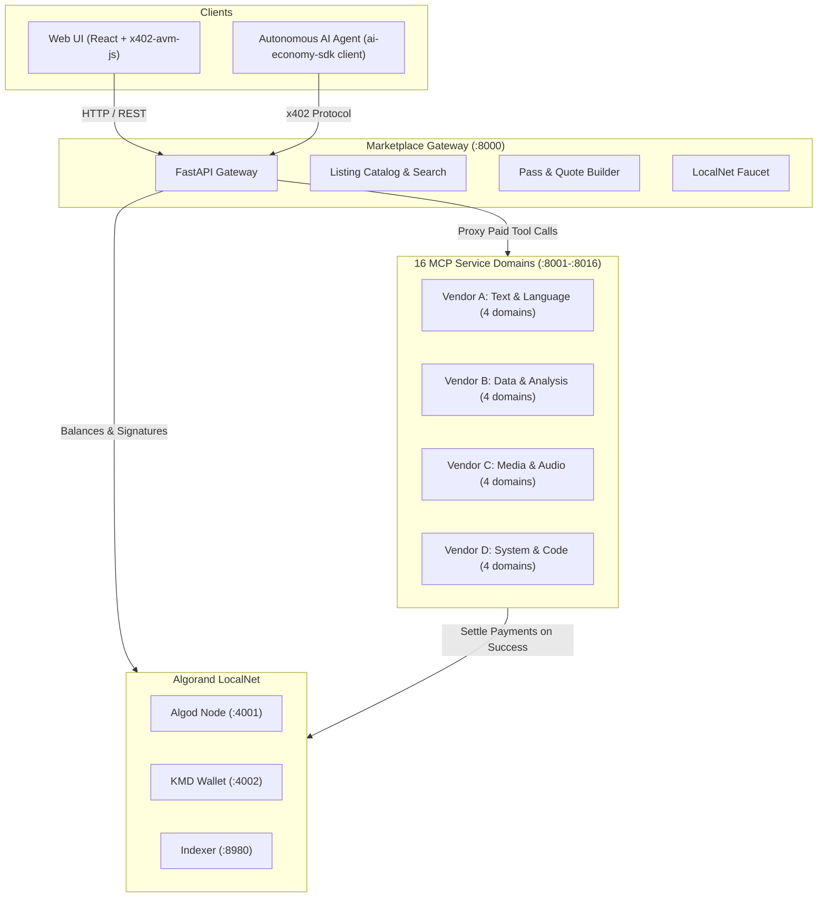

# marketplace-demo

[](https://github.com/x402-avm/marketplace-demo/actions/workflows/ci.yml)
[](https://opensource.org/licenses/MIT)

Reference marketplace demonstration showcasing 64 paid AI tools across 4 independent vendors on Algorand LocalNet.

`marketplace-demo` is a reference integration demonstrating how autonomous AI agents and users discover, purchase, and consume payment-gated Model Context Protocol (MCP) services on Algorand. It integrates `ai-economy-sdk` (Python MCP servers), `x402-algorand` (AVM payment schemes), and `x402-avm-js` (React / TypeScript web frontend) into a cohesive local ecosystem.

> **Note**: This repository is a demonstration and reference integration designed for local development and architecture evaluation. It runs against Algorand LocalNet with simulated funding dispensers. Do not deploy these demo configurations directly to production networks without security review.

## Architecture



## Service Catalog Overview

The marketplace deploys 64 tools partitioned across 4 vendors and 16 service domains:

- **Vendor A (Language & Text)**: Summarization, sentiment analysis, entity extraction, translation.
- **Vendor B (Data & Search)**: Web search, web scraping, SQL querying, JSON transformation.
- **Vendor C (Media & Audio)**: Text-to-speech (Kokoro ONNX), image generation, audio transcoding, OCR.
- **Vendor D (System & Code)**: Shell execution sandbox, git repository analysis, AST linting, PDF reader.

Each tool supports dual-currency payment in native ALGO microAlgos or mUSD (Micro-USD ASA) via `ai-economy-sdk` payment gates.

## Requirements

- Python 3.10+ (Python 3.12 recommended)
- Node.js 22.12+ (or newer) and npm (for the web application)
- Docker and [AlgoKit CLI](https://github.com/algorandfoundation/algokit-cli) (for LocalNet)
- `curl`

## Quickstart

### 1. Start LocalNet

Ensure Docker is running, then start the Algorand LocalNet instance:

```bash
algokit localnet start
```

### 2. Start the Marketplace

Run the one-command startup script:

```bash
./start.sh
```

This script performs the following initialization steps:
1. Verifies Algorand LocalNet health on ports 4001 (Algod), 4002 (KMD), and 8980 (Indexer).
2. Bootstraps LocalNet accounts, mints the mUSD test asset, and funds vendor accounts.
3. Generates the active listing catalog (`servers/marketplace.json`).
4. Starts all 16 MCP service domains in the background.
5. Starts the FastAPI gateway on `http://localhost:8000`.
6. Launches the Vite development server on `http://localhost:5173`.

### 3. Check Status and Stop

Inspect running services and port bindings:

```bash
./status.sh
```

To stop all services:

```bash
./stop.sh
```

## Screenshots

The web user interface includes:

1. `screenshots/01-catalog-grid.png`: Catalog view displaying 64 tools with vendor badges, pricing, and accepted payment assets.
2. `screenshots/02-tool-execution.png`: Tool execution panel demonstrating 402 Payment Required handling, signature verification, and response rendering.
3. `screenshots/03-wallet-balance.png`: LocalNet balance manager with one-click faucet dispensing for ALGO and mUSD.
4. `screenshots/04-vendor-pass.png`: Vendor pass management granting multi-call discounts or time-based access.

*(Screenshots can be captured when running the web UI locally).*

## Testing

### Gateway Offline and Security Tests

Run the gateway offline test suite and security controls without external dependencies:

```bash
cd marketplace/gateway
pytest tests/test_offline.py tests/test_security.py
```

### Chain Scripts Tests

Run unit tests for chain utility scripts:

```bash
cd chain
pytest tests/
```

### Web Frontend Tests and Typecheck

Run TypeScript typechecking and Vitest unit tests:

```bash
cd marketplace/web
npm run build
npm test
```

### Full Integration Tests (Requires LocalNet)

When LocalNet and MCP servers are running:

```bash
cd marketplace/gateway
LOCALNET=1 pytest tests/test_live.py tests/test_paid_live.py
```

## Repository Structure

```
marketplace-demo/
├── chain/                  # Algorand LocalNet bootstrap, listing generation, and tests
├── marketplace/
│   ├── gateway/            # FastAPI reverse proxy, quote engine, and faucet
│   ├── web/                # React / TypeScript frontend utilizing x402-avm-js
│   ├── start.sh            # Service orchestration startup script
│   ├── status.sh           # Service health checker
│   └── stop.sh             # Graceful shutdown script
├── servers/                # 16 payment-gated FastMCP server domains
├── THIRD_PARTY_NOTICES.md  # Third-party licensing documentation
├── AGENTS.md               # Instructions for autonomous AI coding agents
├── LICENSE                 # MIT License
└── README.md
```

## Related Repositories

- [ai-economy-sdk](https://github.com/x402-avm/ai-economy-sdk) - Python MCP payment gateway SDK
- [x402-algorand](https://github.com/x402-avm/x402-algorand) - Algorand payment scheme plugin for x402
- [x402-avm-js](https://github.com/x402-avm/x402-avm-js) - TypeScript/JavaScript client for x402 Algorand payments
- [examples](https://github.com/x402-avm/examples) - Runnable examples on LocalNet, TestNet, and MainNet
- [Documentation](https://x402-avm.github.io) - Complete architecture and protocol guides

## Licences

The `marketplace-demo` repository is licensed under the [MIT License](LICENSE) (Copyright (c) 2026 AI Economy Team).

The `ocr_mcp` and `pdf_mcp` services use [PyMuPDF](https://github.com/pymupdf/PyMuPDF), which is licensed under the GNU Affero General Public License v3.0 ([AGPL-3.0](https://www.gnu.org/licenses/agpl-3.0.html)). Deploying or hosting those specific services over a network requires complying with the AGPL-3.0 terms (or obtaining a commercial license from Artifex). The underlying SDKs (`ai-economy-sdk`, `x402-algorand`, and `x402-avm-js`) do not depend on PyMuPDF.

For full details on all third-party dependencies, model assets, and vendored code, see [THIRD_PARTY_NOTICES.md](THIRD_PARTY_NOTICES.md).
