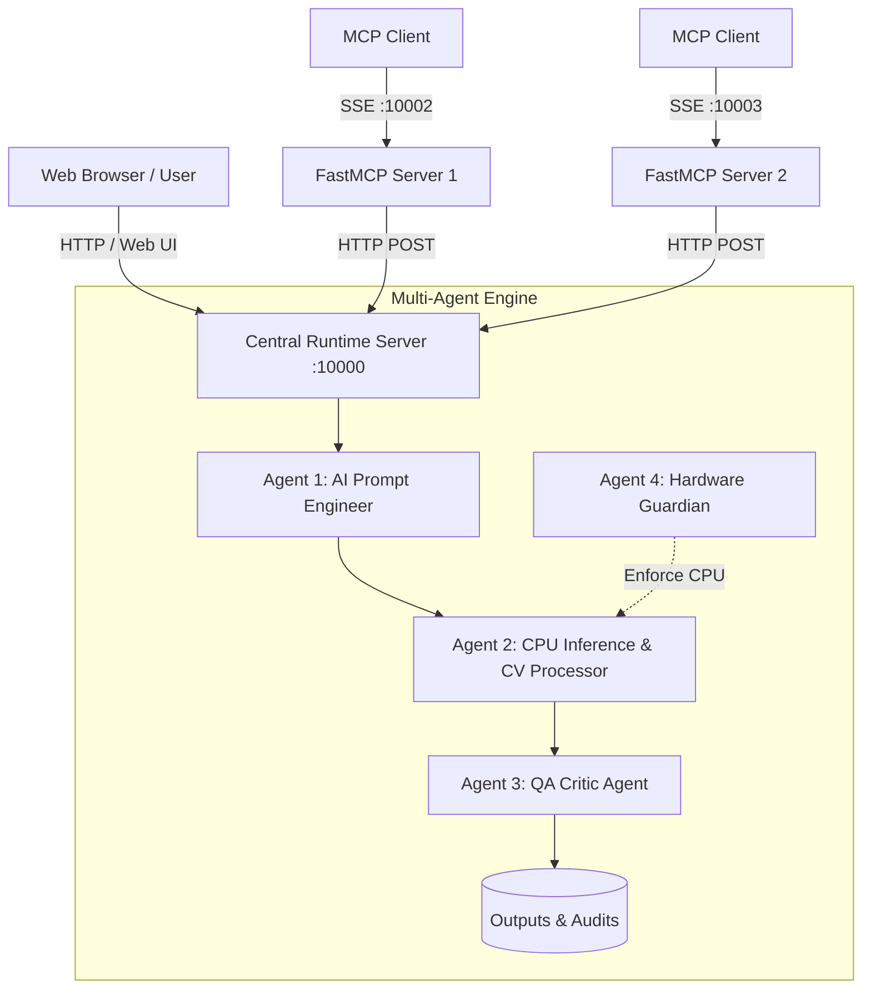

# Gemini Nano Banana Architecture

This project implements a multi-agent image generation & editing system running exclusively on the **AMD Ryzen AI 9 HX 370 CPU (Zen 5, 24 threads)** with complete isolation of the NVIDIA GeForce RTX 4070 discrete GPU.

## Design Principles
- **No ComfyUI**: 100% self-contained native Python architecture.
- **Strict dGPU Isolation**: `CUDA_VISIBLE_DEVICES=""` enforced at process start; discrete GPU is locked out.
- **Port Compliance**: All services strictly bind to ports in the range `10000-10100`.
- **Multi-Agent Orchestration**: Prompt Engineer, CPU Inference Engine, QA Critic, and Hardware Guardian coordinate automatically.

## Topology

