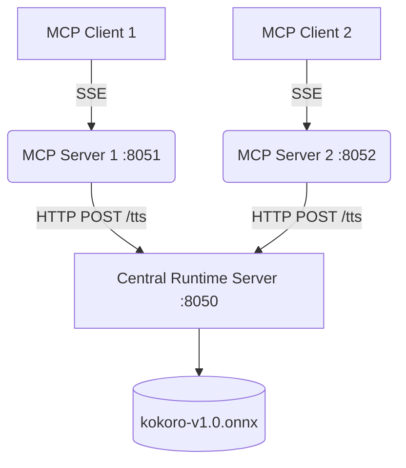

# TTS Architecture

This directory implements a highly efficient, multi-server Model Context Protocol (MCP) system for Text-to-Speech generation using Kokoro-v1.0.

## Design Goals
- **Minimal Memory Footprint**: Ensure VRAM and RAM usage remains under 500-600MB.
- **Concurrent Access**: Allow multiple MCP nodes to generate speech without duplicating model weights.
- **Strict Limitations**: Enforce 1000-character limits per request to prevent OOM errors.

## Topology

### Components
1. **Central Runtime (`runtime_server.py`)**: Responsible for managing the ONNX Inference Session. It loads the `kokoro-v1.0.onnx` model into memory once upon startup.
2. **MCP Nodes (`mcp_server_1.py`, `mcp_server_2.py`)**: Lightweight FastMCP wrappers that expose the `synthesize_speech` tool to any compatible MCP client. They act as reverse proxies to the Central Runtime.
